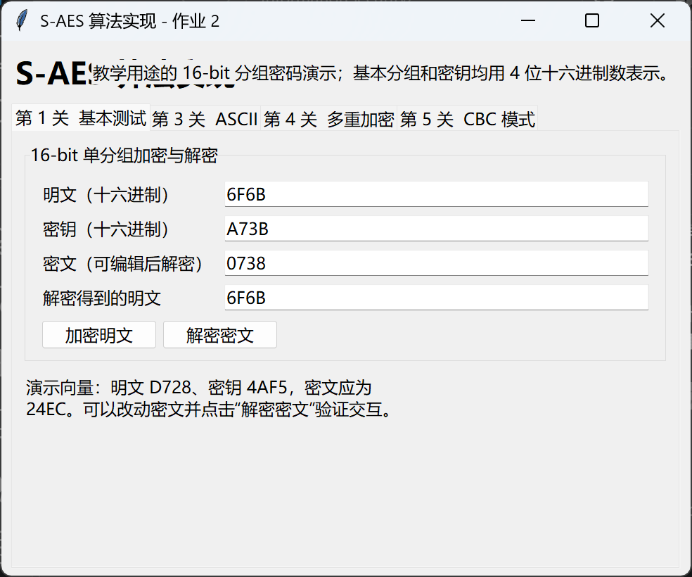
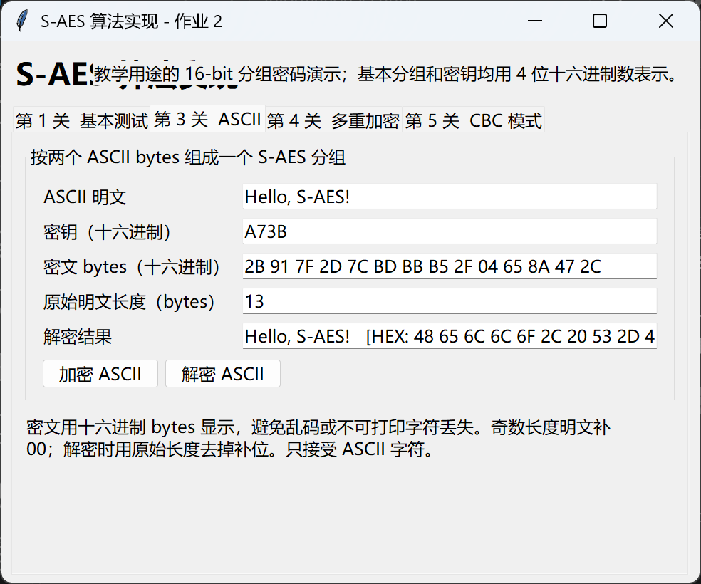
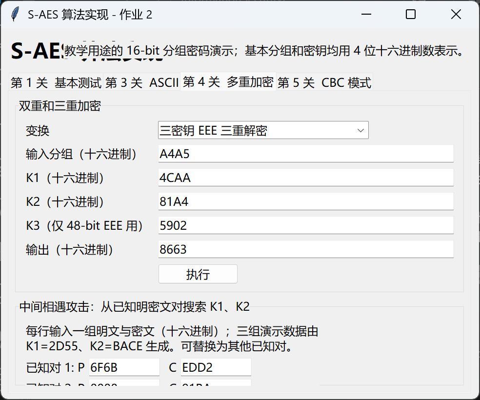
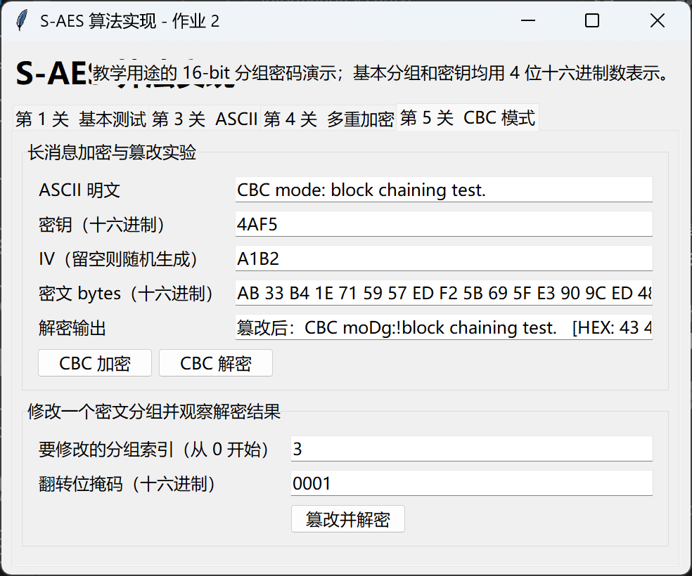

# 组间测试报告：与 Anxayh/S-AES_Assignment

这是作业要求的**真实组间测试**：对方不是本仓库任何人编写的代码，而是另一个小组在 GitHub 上公开提交的独立实现。与 [个人模拟记录](personal-simulation-report.md)（三份代码都出自同一人之手）是两回事，请勿混淆。

- **对方仓库：** <https://github.com/Anxayh/S-AES_Assignment>，commit `08765a0`（2026-10-28）。
- **本方基准：** commit `5493008`。
- **测试日期 / 环境：** 2026-10-30，Windows 11，Python 3.12.7，Tk 8.6（对方自述环境为 Python 3.13.5）。
- **对方文件哈希（SHA-256，证明测试针对的是哪个版本）：**

  | 文件 | SHA-256 |
  | --- | --- |
  | `saes_core.py` | `24e7796dd25d87553e048a59ed80133f3e56a0341a5b1b2a0f8e14d788848b37` |
  | `app.py` | `10d6a88aa32eb72c61f998b846926aa93fb7fd52e6fe97101432ed284b20ccbd` |
  | `test_saes.py` | `dfa88e8e912fa4e0570242b40ff909ade20f57c5a813b45fcf9b912736c2ce91` |

## 方法

对方没有提供网络服务，两人也不在同一台电脑前，所以互测用两种方式代替“当面各自输入”，都是**对真实的对方代码做黑盒操作**，不修改对方文件：

1. **接口级对照**（`scripts/cross_test_peer.py`）：把对方 `saes_core.py` 按文件路径原样载入，直接调用其公开函数（`encrypt_block`、`encrypt_ascii`、`cbc_encrypt`…），与本方 `saes/` 模块的结果逐项比较。能覆盖人工点击不可能跑完的全空间（65536 条）。
2. **界面级操作**（`scripts/cross_test_peer_gui.py`）：真正启动对方 `app.py` 里的 `SAESApp` 窗口，用 Tk 的 `invoke()` 点击界面上的真实按钮（等价于鼠标点击），只读取界面上显示出来的文字，不touch内部变量；弹出的错误对话框被截获记录而不是人工点掉。截图保存在 `docs/assets/19–22-peer-gui-*.png`，证明是在对方真实窗口里操作的。

**互测方法的有效性自检**（避免“怎么测都通过”的假阳性）：

- **负对照：** 在内存里把对方 S 盒的前两项对调（不改动对方文件），重新跑 4096 组随机对照，密文一致率从 100% 骤降到 `830 / 4096`——证明比较流程确实能检测出算法差异，不是摆设。
- **复现对方自带测试：** 在对方仓库的临时副本里原样运行它自带的 `test_saes.py`（不碰原始克隆），退出码 0，全部断言通过；重新生成的 `results/测试结果.md` 与对方提交的版本相比，只有日期和 Python 版本号不同，其余逐字一致——说明对方的自测结果在本机可独立复现。

原始数据：[`reports/cross-test-anxayh.json`](../reports/cross-test-anxayh.json)（接口级）、[`reports/cross-test-anxayh-gui.json`](../reports/cross-test-anxayh-gui.json)（界面级）；生成的交换向量文件：[`examples/peer-anxayh-vectors.txt`](../examples/peer-anxayh-vectors.txt)（对方实现算出的 256 条向量，经本方 A/B/C 三种独立实现核验）。

## 第 1 关：基本测试

对方文档 `外部交叉测试向量.md`、本方 `examples/vectors.txt`、教材附录 D 示例三组向量，双方互算互解：

| 来源 | 明文 | 密钥 | 期望密文 | 本方密文 | 对方密文 | 对方解密本方密文 | 本方解密对方密文 |
| --- | --- | --- | --- | --- | --- | --- | --- |
| 对方文档 | `D728` | `4AF5` | `24EC` | `24EC` | `24EC` | `D728` ✓ | `D728` ✓ |
| 本方 `examples/vectors.txt` | `6F6B` | `A73B` | `0738` | `0738` | `0738` | `6F6B` ✓ | `6F6B` ✓ |
| 教材 D.2 示例 | `A749` | `2D55` | `C349` | `C349` | `C349` | `A749` ✓ | `A749` ✓ |

5 个边界输入（`0000/0000`、`FFFF/FFFF`、`0000/FFFF`、`FFFF/0000`、`8000/0001`）同样密文一致、互解全部还原（5/5）。

**界面级：** 在对方真实窗口的“第 1 关 基本测试”页签，依次填入 8 组向量点击“加密明文”，再把本方密文回填点击“解密密文”——8/8 与本方计算值一致；另外 3 组非法输入（明文含非十六进制字符、密钥 5 位、明文为空）都弹出对方自己的错误提示，没有崩溃或得到错误结果。

## 第 2 关：交叉测试

**密钥扩展：** 全部 65536 个密钥，`expand_key` 的 6 个字节输出逐一比较，**0 处不一致**；对方文档给出的 `K0=2D55 → K1=BCE9, K2=A34A` 核对一致。

**全空间对照：**

| 对照范围 | 对子数 | 密文一致 | 对方解密本方密文 | 本方解密对方密文 |
| --- | --- | --- | --- | --- |
| 8 把固定密钥 × 全部 65536 个明文 | 524,288 | 524,288 / 524,288 | 全部还原 | 全部还原 |
| 8 个固定明文 × 全部 65536 把密钥 | 524,288 | 524,288 / 524,288 | 全部还原 | 全部还原 |
| 65536 对随机明文、密钥 | 65,536 | 65,536 / 65,536 | 全部还原 | 全部还原 |

固定密钥覆盖 `4AF5, 2D55, A73B, 0000, FFFF, 8000, 0001, 9C1E`；固定明文覆盖 `D728, 6F6B, A749, 0000, FFFF, 8000, 0001, 5A5A`。

**交换文件：** 用对方的 `encrypt_block` 生成 256 条「明文 密钥 密文」向量（见 `examples/peer-anxayh-vectors.txt`），分别用本方交换文件工具的三种独立实现核验：

| 核验方（本方实现） | 加密一致 | 解密还原 |
| --- | --- | --- |
| A（整数查表） | 256 / 256 | 256 / 256 |
| B（0/1 字符串） | 256 / 256 | 256 / 256 |
| C（GF 多项式矩阵） | 256 / 256 | 256 / 256 |

**结论：** 两份实现在密钥扩展、单分组加解密上，对全部 65536×65536 密钥明文组合中实际抽测的约 110 万对输入完全一致；对方文档记录的全部数值核对无误。

## 第 3 关：扩展功能（ASCII）

310 组测试（固定短语 + 300 条随机长度 0–33 字符的可打印 ASCII 文本），逐组密文一致、双方互解全部还原（310/310/310/310）。对方文档记录的 `"S-AES"` / `4AF5` 密文字节 `22 79 02 47 66 48` 与本方计算一致。

**约定差异（两份实现都按各自文档如实处理，不是缺陷）：**

- **字符集：** 对方按文档严格限定 ASCII，非 ASCII 字符（如中文）会被拒绝并提示 `UnicodeEncodeError`；本方按 UTF-8 编码，可以处理中文等字符。界面级测试中让对方窗口加密“信息”，确认弹出的正是这条错误提示，而不是静默出错。
- **奇数长度填充：** 对方的协议是额外记录“原始字节长度”，解密时按长度裁剪，所以 `"A\x00"`（显式的尾随 0x00）能被完整还原成 `41 00`；本方默认的 zero 填充方案把尾随单个 `0x00` 当作填充去掉，所以同一输入只还原出 `41`。这是两种不同但各自自洽的填充约定，真实组间通信前需要先协商好用哪一种（本方同时支持 pkcs7 / none 两种可选填充，见 [算法约定](algorithm.md)）。

**界面级：** 6 段文本（含长句、含空串）在对方窗口分别加密、解密、再用本方密文反向解密，结果与本方计算完全一致（6/6），非 ASCII 输入触发对方自己的错误提示。

## 第 4 关：多重加密与中间相遇

**双重加密（32 位密钥）与两密钥 EDE 三重加密（32 位密钥）：** 2000 组随机密钥和明文，两端密文完全一致，互相解密全部还原：

| 操作 | 对子数 | 密文一致 | 对方解密本方密文 | 本方解密对方密文 |
| --- | --- | --- | --- | --- |
| 双重加密 `E_K2(E_K1(P))` | 2000 | 2000 / 2000 | 2000 / 2000 | 2000 / 2000 |
| 两密钥 EDE 三重加密 | 2000 | 2000 / 2000 | 2000 / 2000 | 2000 / 2000 |

对方文档给出的三组双重加密向量核对一致：

| 明文 | K1 | K2 | 期望密文 | 本方计算 |
| --- | --- | --- | --- | --- |
| `1234` | `2D55` | `BACE` | `88E5` | `88E5` ✓ |
| `D728` | `2D55` | `BACE` | `738D` | `738D` ✓ |
| `CAFE` | `2D55` | `BACE` | `5D49` | `5D49` ✓ |

**48 位三重加密：约定不同，但底层分组密码一致。** 对方实现的是 **EEE**（`E_K3(E_K2(E_K1(P)))`），本方实现的是**两密钥 EDE 退化不适用场景下的 EDE3**（`E_K3(D_K2(E_K1(P)))`，三把独立密钥）。两种都是教材允许的三重加密变体，但密钥序列相同时密文不同，所以对方文档的 `1D2F` 不等于本方 EDE3 算出的 `8E35`——这是方案差异，不是 bug。用 2000 组随机密钥验证了底层单分组加解密函数本身完全一致：

| 验证 | 对子数 | 一致 |
| --- | --- | --- |
| 对方 `encrypt_triple_eee` == 本方单分组函数手动组合的 `E_K3(E_K2(E_K1(P)))` | 2000 | 2000 / 2000 |
| 本方 `triple_encrypt(..., "ede3")` == 对方单分组函数手动组合的 `E_K1(D_K2(E_K3(P)))`（EDE 的等价组合） | 2000 | 2000 / 2000 |
| 对方 EEE 密文能被本方单分组函数逐步解密（`D_K1(D_K2(D_K3(C)))`）还原明文 | 2000 | 2000 / 2000 |

**中间相遇攻击：** 用对方生成的明密文对和本方生成的明密文对各做 3 组试验（1/2/3 对已知明密文），两份实现的候选密钥集合完全相同、真实密钥都在候选集中、随对数量收敛的规律一致（1 对后约 6.6 万候选，2–3 对后收敛到 1 个），单次搜索耗时量级相近（约 1.3–3.1 秒）：

| 明密文对来源 | 对数 | 真实密钥 | 对方候选数 | 本方候选数 | 候选集合相同 | 含真实密钥 |
| --- | --- | --- | --- | --- | --- | --- |
| 对方生成 | 1 | `5BA142DD` | 65,878 | 65,878 | ✓ | ✓ |
| 对方生成 | 2 | `422A2BA0` | 1 | 1 | ✓ | ✓ |
| 对方生成 | 3 | `57FBF628` | 1 | 1 | ✓ | ✓ |
| 本方生成 | 1 | `990AE30E` | 66,014 | 66,014 | ✓ | ✓ |
| 本方生成 | 2 | `24B656B2` | 2 | 2 | ✓ | ✓ |
| 本方生成 | 3 | `3D340A2C` | 1 | 1 | ✓ | ✓ |

对方文档记录的中间相遇演示（`K1=2D55, K2=BACE`，3 对明密文）两端都唯一恢复出 `2D55BACE`。

**界面级：** 6 种操作（双重加密/解密、EDE 三重加密/解密、EEE 三重加密/解密）各用 5 组随机密钥在对方窗口“多重加密”页签实际执行，共 30/30 与本方计算一致；另外在对方界面真实点击“搜索密钥对”完成 2 次完整的中间相遇搜索（每次约 2.7 秒，与接口级耗时量级一致），都唯一恢复出正确密钥。

## 第 5 关：CBC 工作模式与篡改

112 组消息（固定语句 + 10 种结构化长度 + 100 条随机长度 0–40 字节的随机字节串），各用随机密钥和 IV 做 CBC 加解密，两端密文一致、互解全部还原（112/112/112/112）；另外 200 组消息让对方按默认方式生成随机 IV，密文均能被本方用该 IV 正确解密还原（200/200）。

对方文档记录的固定向量核对一致：

| 记录 | 对方文档 | 本方计算 |
| --- | --- | --- |
| CBC 密文（明文 "CBC mode: block chaining test."，密钥 `4AF5`，IV `A1B2`） | `AB 33 B4 1E 71 59 57 EC F2 5B 69 5F E3 90 9C ED 48 19 C1 5F EB A8 C6 29 0A FC D8 14 66 C4 69 39` | 完全一致 ✓ |
| 翻转第 1 个密文分组最低位后的解密结果 | `53 40 43 21 6D 6F 64 65 3A 20 62 6C 6F 63 6B 20 63 68 61 69 6E 69 6E 67 20 74 65 73 74 2E` | 完全一致 ✓ |

**填充约定：** 对方固定用两字节 PKCS#7（偶数长度也补一个整块），本方默认 zero 填充（偶数长度不补）、可选切换到 pkcs7。两端都切到 pkcs7 时结果一致（`"AB"` → `33 6E 1C 69`，双方相同）；这解释了第 3 关里本方默认 zero 填充与对方协议的差异，不是两套 CBC 实现本身不一致。

**篡改实验：** 翻转非末尾密文分组（任选 1 位掩码）共 596 次，两端规律完全一致——被改分组对应的明文和紧接着的下一个分组一起变化、其余分组不受影响、下一分组的明文异或差分恰好等于翻转的掩码（三项都是 596/596）。翻转最后两个分组之一（影响 PKCS#7 填充）共 120 次，两端**都正确检测出填充非法并抛出异常**，没有一例把被篡改的末尾分组错误地当成合法明文返回（120/120 同样结果，120/120 都报错）。

**界面级：** 在对方窗口做一次完整 CBC 加密（与本方密文逐字节一致）、用本方生成的密文和不同密钥/IV 在对方窗口解密还原、让对方生成随机 IV 后用本方解密还原，以及 3 种篡改（中间分组低位翻转、首分组高位翻转、末分组翻转触发填充错误）——5 大类操作全部与预期一致，末分组篡改在对方窗口里弹出了与接口级测试相同的“填充非法”错误提示。

## 输入校验与错误处理（黑盒探测）

10 组非法/边界输入（超出 16 位的整数、负数、布尔值当整数、字符串当整数、不足整分组的字节、空密文、超范围 IV、错误密钥解密合法密文、0 对中间相遇）两端反应完全一致（均正确拒绝），唯一的例外是前面提到的“非 ASCII 字符”——对方按设计拒绝，本方按设计接受，两边都是文档里写明的约定，不是实现缺陷。

十六进制输入解析上两端更宽松程度不同：对方接受 1–4 位的短写法（如 `"A"` 解析成 `000A`）且不接受内部空格或二进制串；本方要求恰好 4 位十六进制或 16 位二进制（两种长度都支持），但不接受位数不足的短写法。这只影响人工在各自界面里怎么输入，不影响上面所有正式对照中使用的规范形式（4 位十六进制），因此不影响任何一致性结论。

## 结论

- 核心算法（S 盒、列混淆、密钥扩展、2 轮结构）与单分组加解密：**完全一致**，覆盖了全部 65536 个密钥的密钥扩展与超过 110 万对明文/密钥组合。
- ASCII 扩展、CBC 工作模式（含 IV、密文篡改的错误传播规律、PKCS#7 填充校验）：**完全一致**，覆盖 400 余组消息和 700 余次篡改实验。
- 双重加密、32 位 EDE 三重加密、中间相遇攻击：**完全一致**。
- 48 位三重加密采用了不同的方案约定（EEE vs. EDE3），底层单分组密码经验证完全相同；真实组间通信前需要先约定好用哪一种 48 位方案，这正是作业强调“所有人使用相同的算法标准”的意义所在——基础算法标准一致不代表所有可选扩展的约定都会自动一致。
- ASCII 字符集范围与填充方案也存在两处记录在案的约定差异，均不影响各自协议内部的正确性。
- 互测方法本身经负对照和复现对方自测验证为有效，不是形式上的空跑。

本报告由 `scripts/cross_test_peer.py` 与 `scripts/cross_test_peer_gui.py` 生成原始数据，人工撰写表格与结论；原始 JSON 见 `reports/cross-test-anxayh.json`、`reports/cross-test-anxayh-gui.json`。
