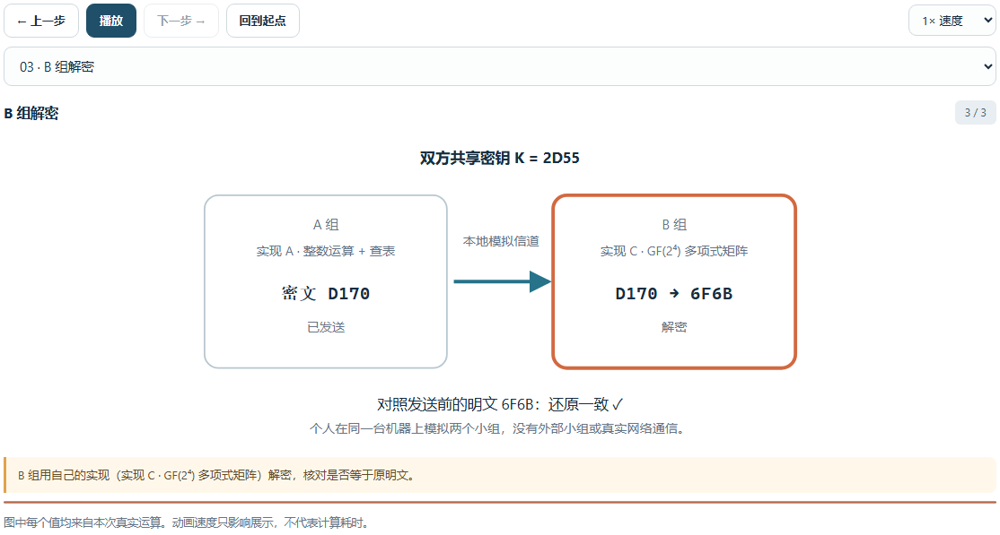

# 五关测试结果

本文件由 `scripts/generate_report.py` 根据本机真实运行结果生成，原始数据见 [experiments.json](../reports/experiments.json)。随机数使用固定种子可复现；耗时随硬件、负载变化，不作为性能承诺。环境：Python 3.12.7 / Windows，生成日期 2026-10-21。

**完成方式：个人单人完成全部五关的开发与自测。** 组内测试用三种结构不同的独立实现（A 整数查表、B 0/1 字符串、C GF 多项式矩阵）模拟三位成员，这部分**没有其他同学或其他小组参与，是个人模拟**。在此基础上，已与另一小组 [Anxayh/S-AES_Assignment](https://github.com/Anxayh/S-AES_Assignment) 公开提交的独立实现完成**真实组间测试**，方法与结论见[组间测试报告](cross-test-report.md)、记录见本文末尾的记录表。浏览器端到端检查 52/52 项通过（Chrome/155.0.8059.85，2026-10-21）。

## 总览

| 关卡 | 要求 | 本项目的完成情况 | 证据 |
| --- | --- | --- | --- |
| 第 1 关 基本测试 | GUI；16 位数据 + 16 位密钥 → 16 位密文 | 网页 GUI 支持加密 / 解密，复刻教材图 D.1–D.5 的 13 步分步图解 | [第 1 关](#第-1-关基本测试) |
| 第 2 关 交叉测试 | 相同算法标准，A / B 组互相加解密一致 | 组内三实现互验、A 组 ↔ B 组互测、交换文件；全空间对照 | [第 2 关](#第-2-关交叉测试) |
| 第 3 关 扩展功能 | ASCII 字符串（2 字节一组），输出可为乱码字符串 | 字符串 ↔ 分组 ↔ 密文，十六进制 / Base64 / 乱码三种视图 | [第 3 关](#第-3-关扩展功能) |
| 第 4 关 多重加密 | 双重（32 位）、中间相遇攻击、三重（32 或 48 位） | 双重、中间相遇攻击（含候选收敛图）、三重两种模式都实现 | [第 4 关](#第-4-关多重加密) |
| 第 5 关 工作模式 | CBC，16 位 IV 双方共享；篡改密文分组后对比解密 | CBC 加解密、传输包 = IV ‖ 密文、四种篡改方式的对比实验 | [第 5 关](#第-5-关工作模式) |

网页上的“一键闯关”按钮会重新运行每一关的自检（教材示例、已知向量、固定种子的随机数据、三种实现互相核对），当前 **5/5 通过**：

## 第 1 关：基本测试

**要求：** 提供 GUI 支持用户交互；输入 16 位数据和 16 位密钥，输出 16 位密文（并能解密）。

**操作与界面：** 输入框接受 16 位二进制或 4 位十六进制，并即时显示另一种写法。点击“运行并查看过程”后，右侧显示密文、三个轮密钥和反方向回验；下方图解按教材顺序依次展示数据结构（图 D.2）、密钥扩展（图 D.5）和 8 个加密 / 解密变换（图 D.1、D.3、D.4）。

### 已知向量 P = `6F6B`，K = `A73B` → C = `0738`

轮密钥 K₀ / K₁ / K₂ = `A73B` / `1C27` / `7651`。每一步之后的 16 位状态（手工可复核，见[算法说明](algorithm.md#可手工复核的例子)）：

| 步骤 | 变换 | 之后的状态 |
| --- | --- | --- |
| 0 | 输入 P | `6F6B` |
| 1 | 第 0 轮 · A_K0 轮密钥加 | `C850` |
| 2 | 第 1 轮 · NS 半字节代替 | `C619` |
| 3 | 第 1 轮 · SR 行移位 | `C916` |
| 4 | 第 1 轮 · MC 列混淆 | `ECA2` |
| 5 | 第 1 轮 · A_K1 轮密钥加 | `F085` |
| 6 | 第 2 轮 · NS 半字节代替 | `7961` |
| 7 | 第 2 轮 · SR 行移位 | `7169` |
| 8 | 第 2 轮 · A_K2 轮密钥加 | `0738` |

解密回验：对 `0738` 用同一密钥解密，得到 `6F6B`。

### 教材附录 D 的示例逐项复现

教材 D.2.1–D.2.4 的四个示例恰好是 **P = A749、K = 2D55** 这一次加密的前四步（页面“载入示例”可一键复现），D.3 的密钥扩展示例使用同一把密钥：

| 教材位置 | 教材给出的结果 | 本程序的结果 |
| --- | --- | --- |
| D.2.1 轮密钥加 [[A,4],[7,9]] ⊕ [[2,5],[D,5]] | [[8,1],[A,C]] | 状态 `8A1C` |
| D.2.2 半字节代替 | [[6,4],[0,C]] | 状态 `604C` |
| D.2.3 行移位 | [[6,4],[C,0]] | 状态 `6C40` |
| D.2.4 列混淆 | [[3,4],[7,3]] | 状态 `3743` |
| D.3 密钥扩展 w₂…w₅（密钥 2D55） | 10111100 11101001 10100011 01001010 | `10111100` `11101001` `10100011` `01001010` |

（状态按教材图 D.2 的列优先顺序写成 4 个十六进制数 N₀N₁N₂N₃，例如 `8A1C` 就是矩阵 [[8,1],[A,C]]。）

### 全空间与边界检查

| 检查 | 结果 |
| --- | --- |
| 密钥 2D55：65536 个明文的密文互不相同（加密是排列） | 65536 / 65536 |
| 密钥 0000：65536 个明文的密文互不相同（加密是排列） | 65536 / 65536 |
| 密钥 FFFF：65536 个明文的密文互不相同（加密是排列） | 65536 / 65536 |
| 密钥 2D55：解密 ∘ 加密 = 恒等 | 65536 / 65536 |
| 密钥 0000：解密 ∘ 加密 = 恒等 | 65536 / 65536 |
| 密钥 FFFF：解密 ∘ 加密 = 恒等 | 65536 / 65536 |

边界输入（全 0、全 1、最高位等）：

| 明文 | 密钥 | 密文 | 解密还原 |
| --- | --- | --- | --- |
| `0000` | `0000` | `071E` | `0000` |
| `FFFF` | `FFFF` | `5343` | `FFFF` |
| `0000` | `FFFF` | `08C1` | `0000` |
| `FFFF` | `0000` | `2930` | `FFFF` |
| `8000` | `0001` | `BE05` | `8000` |

非法输入（长度不对、含非 0/1 或非十六进制字符）会即时提示，提交后由后端返回明确的错误信息，不会静默补零或截断。教材示例、逐项变换及自检共 11 项见网页“一键闯关”。

**结论：** 加密、解密均与教材示例逐项一致，已知向量 `6F6B / A73B → 0738` 的每一步状态可手工复核；加密在固定密钥下是 65536 个分组上的排列。

## 第 2 关：交叉测试

**要求：** 所有人使用相同的算法流程和转换单元（S 盒、列混淆矩阵等）。两组使用相同密钥对同一明文加密应得到相同密文；一组加密的密文，另一组的程序解密应得到同一明文。

**个人完成方式：** 把“另一位同学 / 另一组”换成结构不同的独立实现——A 用整数位运算与查表；B 全程使用 0/1 字符串，列混淆用“乘 x”位运算；C 用 GF(2⁴) 多项式矩阵，S 盒由“求逆 + 仿射变换”构造，解密采用教材 D.5 的等价逆算法。三份代码互不导入对方的常量与函数。

### 组内测试：三种实现互验

密钥 `A73B`，8 个典型明文：

| 明文 P | 实现 A 密文 | 实现 B 密文 | 实现 C 密文 | 是否一致 |
| --- | --- | --- | --- | --- |
| `6F6B` | `0738` | `0738` | `0738` | ✓ |
| `0000` | `90A6` | `90A6` | `90A6` | ✓ |
| `FFFF` | `3B40` | `3B40` | `3B40` | ✓ |
| `0001` | `30AD` | `30AD` | `30AD` | ✓ |
| `8000` | `20A5` | `20A5` | `20A5` | ✓ |
| `1234` | `9B24` | `9B24` | `9B24` | ✓ |
| `A5A5` | `37A5` | `37A5` | `37A5` | ✓ |
| `5A5A` | `6104` | `6104` | `6104` | ✓ |

全空间对照（真实运行 65536 + 65536 个输入，每个输入三种实现各算一遍）：

| 对照范围 | 三种实现密文一致 | A 的密文由 A / B / C 解密还原 |
| --- | --- | --- |
| 固定密钥 2D55，遍历全部 65536 个明文 | 65536 / 65536 | 196608 / 196608 |
| 固定明文 6F6B，遍历全部 65536 把密钥 | 65536 / 65536 | 196608 / 196608 |
| 密钥 2D55，随机 2048 个明文，3×3 交叉解密 | 2048 / 2048 | 18432 / 18432（9 种加解密组合） |

### 组间测试：A 组 ↔ B 组

两组共享密钥 `2D55`，对 256 个明文分别计算，再交换密文互相解密：

| A 组实现 | B 组实现 | 密文一致 | A → B 解密还原 | B → A 解密还原 |
| --- | --- | --- | --- | --- |
| A | B | 256 / 256 | 256 / 256 | 256 / 256 |
| A | C | 256 / 256 | 256 / 256 | 256 / 256 |
| B | C | 256 / 256 | 256 / 256 | 256 / 256 |

页面上可以任意选择两组各用哪种实现，并回放“加密 → 模拟信道 → 解密”的传输动画：

### 与其他小组交换测试向量

真实的组间测试需要对方的程序。本项目提供两种交换格式（[格式说明](algorithm.md#交叉测试交换格式)）：JSON 文件和每行「明文 密钥 密文」的纯文本。个人自检结果：

| 检查 | 结果 |
| --- | --- |
| 实现 A 导出 8 条向量，分别由实现 A / B / C 核验 | A 通过 / B 通过 / C 通过 |
| 改动其中一条密文后由实现 C 核验 | 检出不一致（加密一致 7/8，解密一致 7/8） |
| 算法标识（spec_id）不同的交换文件 | 被拒绝，并提示先核对 S 盒、列混淆矩阵、密钥扩展常量和半字节排列 |
| 纯文本向量（十六进制与二进制混写、带注释） | 可直接粘贴核验 |

**结论：** 三种结构不同的实现在全部 65536 个明文和全部 65536 把密钥上的密文完全一致、互相解密全部还原，说明算法流程与转换单元按教材标准执行。因为三份代码同出一人之手，这不能替代真人跨组测试；与另一小组的真实组间测试见下方记录表和[组间测试报告](cross-test-report.md)。

## 第 3 关：扩展功能

**要求：** 加密算法的数据输入可以是 ASCII 编码字符串（分组为 2 字节），对应地输出也可以是 ASCII 字符串（很可能是乱码）。

**约定：** 字符串先编码成字节（ASCII 字符与 ASCII 编码完全相同，中文等按 UTF-8），每 2 字节组成一个 16 位分组（高字节在前，例如 `"AB"` = `0x4142`），逐组独立加密。奇数字节需要填充：默认补一个 `0x00`（偶数长度时与不填充完全相同，便于与其他小组对照），也可选 PKCS#7 或“无填充”（奇数时拒绝）。密文字节多半不可打印，所以同时提供十六进制、Base64 和“乱码字符串”视图。

密钥 `A73B`：

| 明文 | 字节（十六进制） | 分组数 | 密文（十六进制） | 乱码字符串视图 | 解密还原 |
| --- | --- | --- | --- | --- | --- |
| "Hello, S-AES!" | `48656C6C6F2C20532D41455321` | 7 | `2B917F2D7CBDBBB52F04658A472C` | `+··-|···/·e·G,` | "Hello, S-AES!" |
| "AB" | `4142` | 1 | `F014` | `··` | "AB" |
| "ABABABAB" | `4142414241424142` | 4 | `F014F014F014F014` | `········` | "ABABABAB" |
| "" | `（空）` | 0 | `（空）` | `（空）` | "" |
| "A" | `41` | 1 | `D729` | `·)` | "A" |
| "信息安全" | `E4BFA1E681AFE5AE89E585A8` | 6 | `93A86C5873D617ADD74F37A3` | `··lXs····O7·` | "信息安全" |

奇数字节（`abc`，3 字节）的三种填充方式：

| 填充方式 | 填充后字节 | 密文 | 还原 / 结果 |
| --- | --- | --- | --- |
| zero | `61626300` | `65423F31` | `abc` |
| pkcs7 | `61626301` | `65429F33` | `abc` |
| none | `—` | `—` | 拒绝：选择「无填充」时，明文字节数必须是偶数 |

观察：`ABABABAB` 的 4 个相同分组得到 4 个相同的密文分组——逐组独立加密（ECB）会暴露重复模式，这正是第 5 关引入 CBC 的原因。

**结论：** 字符串（含空串、奇数长度、中文）加密再解密均能还原；非法的“无填充 + 奇数字节”被拒绝并提示。

## 第 4 关：多重加密

### 双重加密（32 位密钥）

约定：密钥 K = K1 ‖ K2（K1 在高 16 位），**C = E_K2( E_K1( P ) )，P = D_K1( D_K2( C ) )**。

| 明文 P | 密钥 K1‖K2 | 密文 C |
| --- | --- | --- |
| `6F6B` | `2D55A73B` | `1977` |
| `1234` | `2D55A73B` | `84BA` |
| `BEEF` | `2D55A73B` | `868E` |

### 中间相遇攻击

已知若干对使用同一把 32 位密钥的明文 / 密文，枚举全部 2¹⁶ 个 K1 得到中间值表 E_K1(P)，再枚举全部 2¹⁶ 个 K2 计算 D_K2(C) 并查表，命中的 (K1, K2) 即候选；其余明密文对逐个验证候选。总计约 2×2¹⁶ 次分组运算，而不是穷举的 2³² 次。

固定种子的 6 次试验（每次随机选一把 32 位密钥，给出 3 对明密文）：

| 种子 | 真实密钥 K1‖K2 | 候选数：1 对 → 2 对 → 3 对 | 唯一且包含真实密钥 | 分组运算次数 | 总耗时 / ms | 其中建表 / ms |
| --- | --- | --- | --- | --- | --- | --- |
| 1 | `2265B1F5` | 65,603 → 1 → 1 | ✓ | 262,280 | 2739.7 | 628.8 |
| 2 | `F4BEA973` | 65,689 → 1 → 1 | ✓ | 262,452 | 3024.0 | 885.8 |
| 3 | `3CEB3FFD` | 65,591 → 3 → 1 | ✓ | 262,260 | 3114.0 | 635.8 |
| 4 | `3C6DA5D7` | 65,627 → 1 → 1 | ✓ | 262,328 | 2707.4 | 642.4 |
| 5 | `9F767C45` | 66,254 → 2 → 1 | ✓ | 263,584 | 2973.7 | 783.7 |
| 6 | `CB1855FE` | 65,390 → 4 → 1 | ✓ | 261,860 | 2781.6 | 619.0 |

观察：**单对明密文远远不够**——只给 1 对时剩下约 6.5 万个候选（≈ 2³² / 2¹⁶）；2 对后平均约 2.0 个；3 对后唯一。这与理论预期一致：每增加一对，候选数大约除以 2¹⁶。

运算量与时间：本机实测单次分组加密 9.12 µs（实现 A）；穷举 2³² 把双重密钥最优也需约 4,295,032,832 次加密，按此速度**估算**约 9.7 小时（估算值，不是实测）；中间相遇实测约 2.9 秒，运算量约为穷举的 1/16,376。

### 三重加密

两种模式（EDE）：32 位密钥 K1‖K2 用 **C = E_K1( D_K2( E_K1( P ) ) )**；48 位密钥 K1‖K2‖K3 用 **C = E_K3( D_K2( E_K1( P ) ) )**。本项目两种都实现。P = `6F6B`：

| 模式 | 密钥 | 密文 C | 解密还原 |
| --- | --- | --- | --- |
| EDE2 | `2D55A73B` | `3218` | `6F6B` |
| EDE3 | `2D55A73B1C27` | `2DC6` | `6F6B` |

K1 = K2 时 EDE2 退化为单重加密（已在自检中验证）。

**结论：** 双重加密并没有把安全强度提高到 32 位密钥空间应有的水平（攻击约 2¹⁷ 次运算，只比单重多一个常数倍和 2¹⁶ 项的内存）；这也是实际中采用三重加密的原因。

## 第 5 关：工作模式

**要求：** 使用 CBC 对较长的明文加密，初始向量（16 位）的生成与双方共享；对密文分组替换或修改后解密，对比篡改前后的结果。

**约定：** C₀ = IV，Cᵢ = E_K( Pᵢ ⊕ Cᵢ₋₁ )；解密 Pᵢ = D_K( Cᵢ ) ⊕ Cᵢ₋₁。IV 随机生成（浏览器 `crypto.getRandomValues`），不需要保密，但必须与密文一起交给接收方，所以页面给出“传输包 = IV ‖ 密文”。

明文：`CBC mode demo: AAAAAAAAAAAAAAAA tamper with one block and compare.`，密钥 `A73B`，IV `1234`，共 33 个分组（前 8 个）：

| # | 明文 Pᵢ | Cᵢ₋₁（或 IV） | Pᵢ ⊕ Cᵢ₋₁ | 密文 Cᵢ |
| --- | --- | --- | --- | --- |
| 1 | `4342` | `1234` | `5176` | `497F` |
| 2 | `4320` | `497F` | `0A5F` | `E105` |
| 3 | `6D6F` | `E105` | `8C6A` | `1F29` |
| 4 | `6465` | `1F29` | `7B4C` | `1AFC` |
| 5 | `2064` | `1AFC` | `3A98` | `5426` |
| 6 | `656D` | `5426` | `314B` | `301F` |
| 7 | `6F3A` | `301F` | `5F25` | `0CBD` |
| 8 | `2041` | `0CBD` | `2CFC` | `E2FB` |

同一段明文里连续 16 个 `A`：ECB 得到 **7** 个重复的密文分组，CBC 得到 **0** 个。使用错误的 IV（差 1 位）解密：只有第 1 个明文分组出错，其余分组完全正确。

### 篡改密文分组再解密

| 改动方式 | 被改动的密文分组 | 整块乱码 | 位翻转（可预测） | 不受影响 | 位翻转与 Cᵢ₋₁ ⊕ C′ᵢ₋₁ 吻合 |
| --- | --- | --- | --- | --- | --- |
| 把分组 #4 的密文替换为分组 #2 的密文 | #4 | 1 | 1 | 31 | ✓ |
| 翻转分组 #10 的第 0 位（b0） | #10 | 1 | 1 | 31 | ✓ |
| 把分组 #1 的密文设为 DEAD | #1 | 1 | 1 | 31 | ✓ |
| 交换分组 #3 与 #6 | #3、#6 | 2 | 2 | 29 | ✓ |

规律（与 CBC 的定义完全一致）：

- 被改动的密文分组 Cᵢ：对应的明文分组 Pᵢ = D(C′ᵢ) ⊕ Cᵢ₋₁ **整块变成乱码**。
- 紧接着的明文分组 Pᵢ₊₁ = D(Cᵢ₊₁) ⊕ C′ᵢ：它自己的密文没变，但与原文**恰好相差 Cᵢ ⊕ C′ᵢ**——攻击者可以通过修改 Cᵢ 来有意翻转 Pᵢ₊₁ 中指定的比特（代价是 Pᵢ 被毁）。
- 其余分组完全不受影响：错误传播只波及两个分组。

页面用图标 + 文字 + 色条同时标注每个分组的状态（未受影响 ✓、位翻转 ⚠、整块乱码 ✕），不只靠颜色：

**结论：** CBC 隐藏了明文的重复模式，错误传播范围与理论一致；但 CBC 本身不提供完整性保护，篡改可以被有意利用，实际使用需要配合消息认证。

## 代码规范

- **命名：** Python 使用 snake_case、JavaScript 使用 camelCase，函数和变量名描述用途（如 `substitute_nibbles`、`meet_in_the_middle`、`cbc_decrypt_blocks`），避免单字符名（仅限循环下标等临时变量）。
- **注释：** 只在算法含义、教材对应关系和不明显的约定处写简短中文注释；模块与公开函数带说明文档字符串，对外接口见[开发手册](developer-guide.md)。
- **函数式编程：** 加解密流程用数据（`ENCRYPT_PLAN` / `DECRYPT_PLAN`）描述，计算与图解轨迹共用同一份；各变换是纯函数，用 `reduce`、`accumulate` 等组合；重复逻辑抽成函数复用。

## 真人组间测试记录

| 日期 | 对方（小组 / 同学） | 对方语言 / 平台 | 测试内容 | 向量条数 | 加密一致 | 解密还原 | 备注 |
| --- | --- | --- | --- | --- | --- | --- | --- |
| 2026-10-30 | [Anxayh/S-AES_Assignment](https://github.com/Anxayh/S-AES_Assignment)（commit `08765a0`） | Python + Tkinter | 五关全覆盖：基本测试、密钥扩展全空间、交换文件、ASCII、双重/EDE 三重加密、中间相遇、CBC 与密文篡改；含对方真实 GUI 的界面级操作（截图为证） | 约 110 万对单分组 + 400 余组 ASCII/CBC + 千余组多重加密 | 全部一致（48 位三重加密 EEE/EDE3 约定不同，底层密码验证一致，见报告） | 全部还原 | 详见 [组间测试报告](cross-test-report.md)；本次为脚本驱动对方真实代码与真实界面，非人工逐条输入，但对方代码为独立第三方实现，不是个人模拟 |
