# 用户指南

## 启动

在仓库根目录运行：

```bash
python app.py
```

然后用浏览器打开 **http://127.0.0.1:8766**。需要 Python 3.10 或以上，只用标准库，不需要安装任何第三方包，也不需要 Node、Qt 或数据库。端口被占用时用 `python app.py --port 8767`，浏览器地址相应更换。结束时在终端按 `Ctrl+C`。

服务只监听本机（`127.0.0.1`），页面不访问任何外部网络，输入的数据不会离开你的电脑。关闭终端里的服务后，页面就不能继续计算了。

页面顶部是六个标签：五道关卡加上“一键闯关”。键盘上用 ← → 键、Home、End 可以在标签之间切换。每个关卡第一次打开时会自动运行一个默认示例，所以打开就能看到结果。

## 数据怎么写

所有 16 位的数据和密钥都可以写成 **16 位二进制**（可含空格，如 `0110 1111 0110 1011`）或 **4 位十六进制**（如 `6F6B`，可带 `0x`）。第 1 关的输入框下面会即时显示你输入的值对应的另一种写法，长度不对时直接提示，不会自动补零。第 4 关的 32 位、48 位密钥同理（8 / 12 位十六进制，或 32 / 48 位二进制），由后端检查长度。

## 第 1 关：加解密与分步图解

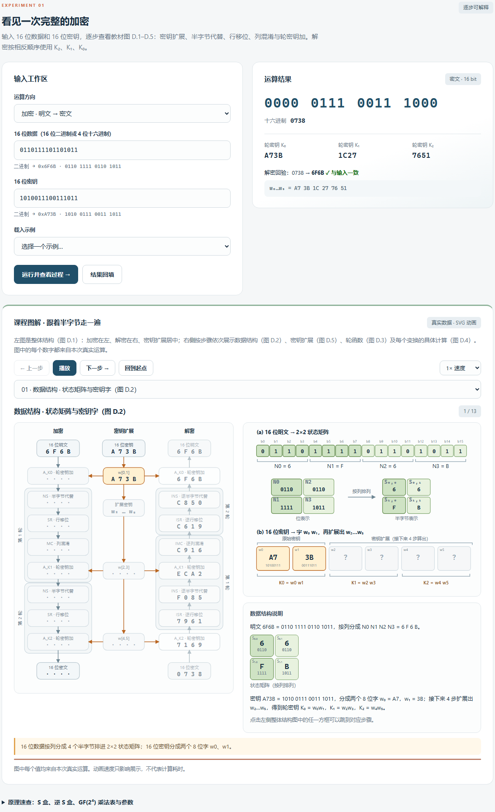

1. 默认的输入是 `P = 6F6B`、`K = A73B`，点击“运行并查看过程”，密文应为 `0738`，三个轮密钥 K₀/K₁/K₂ 为 `A73B / 1C27 / 7651`。结果卡片里还有反方向回验（对密文解密应还原 `6F6B`）。
2. “运算方向”切换加密 / 解密；“结果回填”把结果填回输入框并自动切换方向，再运行就是回验；“载入示例”可以一键载入已知向量、教材附录 D 的连贯示例（`A749 / 2D55`）和全零向量。
3. 下方“课程图解”按真实计算顺序共 13 步：1 个数据结构步骤、4 个密钥扩展步骤、8 个加密（或解密）变换。用“上一步 / 下一步”逐步查看，“播放”自动演示（可调速度），或在下拉框里直接跳到某一步；也可以点击左侧整体结构图里的任一方框跳转。动画只用于讲解，不代表计算耗时。

图解的布局对应教材附录 D：

| 区域 | 教材图 | 看什么 |
| --- | --- | --- |
| 左：整体结构 | 图 D.1 | 加密在左、解密在右、密钥扩展居中；每个方框显示该变换之后的状态，当前步骤高亮；未执行的步骤显示 `····`；另一侧淡色显示反方向的完整验算 |
| 右上（第 1 步） | 图 D.2 | 16 位数据按列排进 2×2 状态矩阵，密钥分成 w₀、w₁ |
| 右上（第 2–5 步） | 图 D.5 | 密钥扩展：(a) w₀…w₅ 的生成，(b) g 函数的 RotNib / SubNib / ⊕ RCON |
| 右上（第 6–13 步） | 图 D.3 | 一轮里的 S 盒、行移位的交叉连线、列混淆的 M 框、与轮密钥 r₀…r₃ 的 ⊕；两色底纹对应状态矩阵的两列 |
| 右下 | 图 D.4 及示例 | 当前变换的具体计算 |

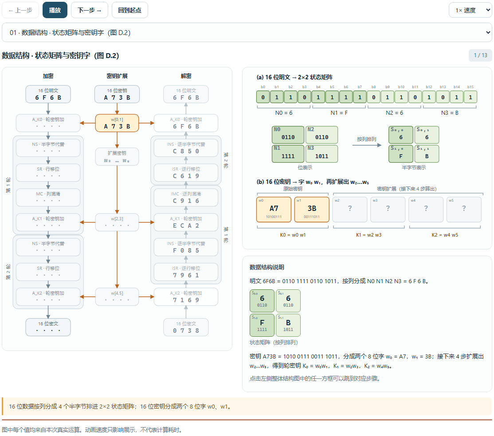

各变换的细节面板：

- **半字节代替**：每个半字节用左 2 位选行、右 2 位选列，S 盒表格里对应格子用四种颜色高亮并标上 N0–N3，下方列出“C = 1100 → 行 11 · 列 00 → C”。
- **行移位**：第二行的两个半字节互换，逆行移位与它相同。
- **列混淆**：`M × 状态` 的矩阵等式，以及 `S′₀,₀ = 1·C ⊕ 4·9 = C ⊕ 2 = E` 这样的逐项算式；每个非平凡的 GF(2⁴) 乘法都附多项式推导（如 `4·C = x²·(x³+x²) = x⁵+x⁴ ≡ x²+1 = 5`）。
- **轮密钥加**：状态矩阵 ⊕ 轮密钥矩阵 = 新状态矩阵，并逐半字节给出二进制异或。
- **密钥扩展**：逐位对齐的二进制算式（RotNib、SubNib、⊕ RCON、⊕ 前一字）。

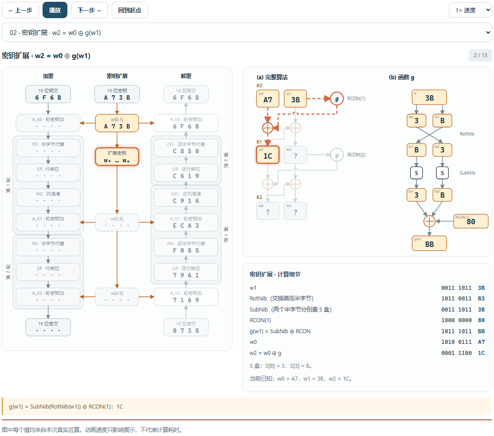

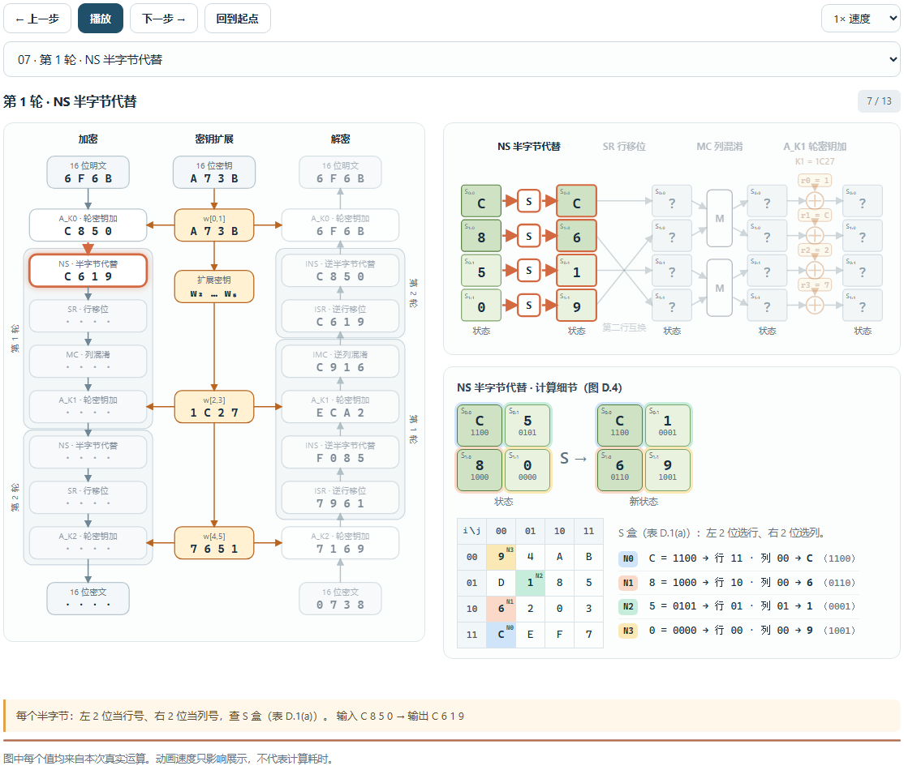

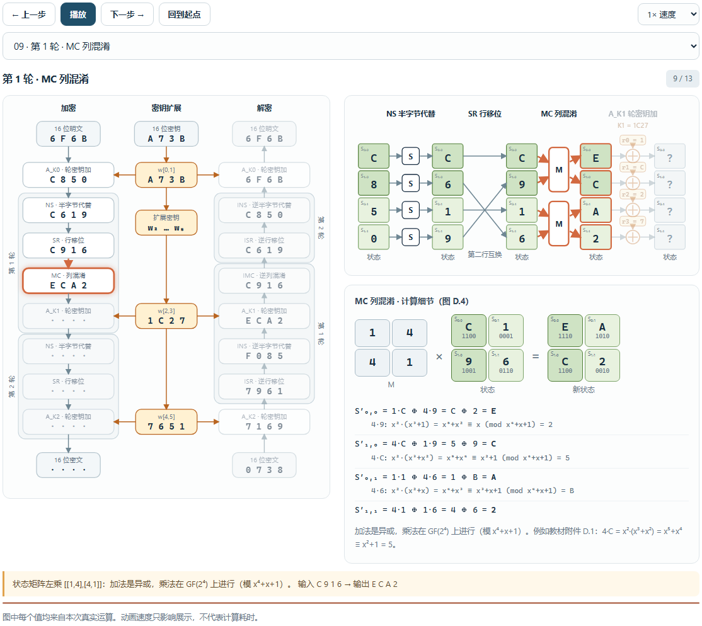

解密图解把同样的变换反向执行（A_K2、ISR、INS、A_K1、IMC、ISR、INS、A_K0），整体结构图的右侧是它的数据流：

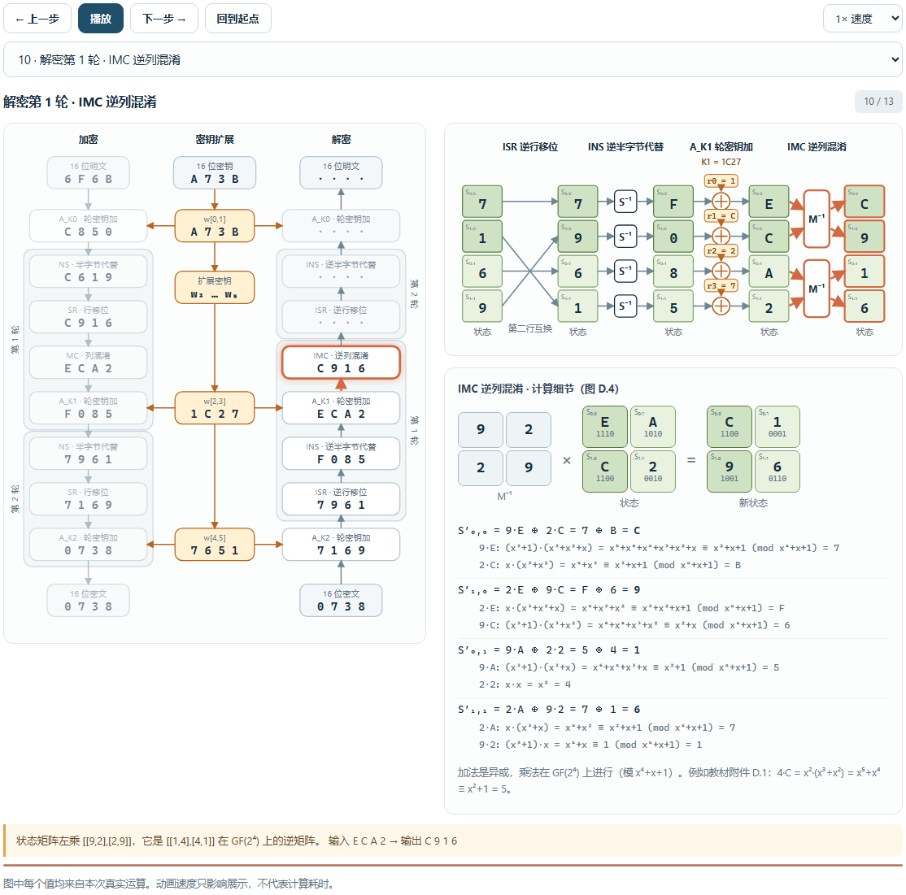

“原理速查”展开后可以看到 S 盒、逆 S 盒、GF(2⁴) 乘法表、列混淆矩阵与轮常数。

## 第 2 关：组内、组间互测与交换文件

作业的第 2 关要求不同组的程序对同一明文、同一密钥得到相同密文，并能互相解密。三个人一组、各自实现时，这就是组内测试；不同小组之间就是组间测试。一个人操作时，页面提供三种结构不同的独立实现 A（整数查表）、B（0/1 字符串）、C（GF 多项式矩阵）来代替“其他人 / 其他组”。**这是个人模拟，不冒充真人互测。** 与另一小组的真实组间测试见 [组间测试报告](cross-test-report.md)。

**A 组内测试：** 填入共享密钥和若干明文（每行一个），点击“运行组内互验”，三种实现各自加密，比较密文是否一致，再做 3×3 的交叉解密（谁加密 × 谁解密）。点击表格里的某一行，下方显示这一行的 3×3 矩阵。“随机 256 个明文”一次检查更多数据。

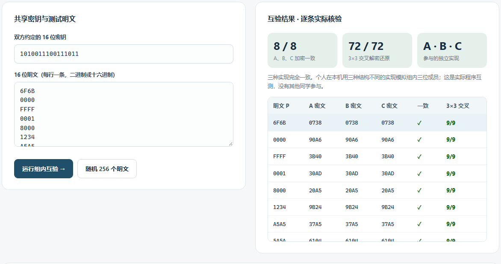

**B 组间测试：** 选择 A 组、B 组各用哪种实现，填入共享密钥和明文，点击“运行 A / B 组互测”。统计包括“两组密文一致”“A→B 解密还原”“B→A 解密还原”三项；表格每行有“回放”按钮，下方的动画演示“加密 → 模拟信道 → 解密”（可切换方向）。“下载个人模拟记录”保存完整数据。

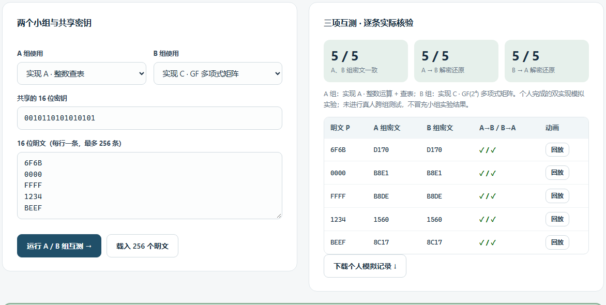

**C 交换文件**（用于真实组间测试）：见下一节。

### 与其他小组交叉测试

真实的组间测试需要对方的程序。推荐流程：

1. **先核对约定。** 双方对照[算法说明](algorithm.md#交叉测试交换格式)末尾的“互测前核对清单”（位序、半字节按列排列、S 盒、行移位、列混淆矩阵、第 2 轮没有列混淆、密钥扩展与 RCON）。用已知向量 `6F6B / A73B → 0738` 和教材连贯示例 `A749 / 2D55 → C349` 先对一遍。
2. **把我们的向量给对方核验。** 在“生成测试向量给对方”里填密钥和明文，点“下载 JSON 交换文件”或“复制纯文本向量”（每行 `明文 密钥 密文`），发给对方。对方用自己的程序加密、解密，看是否与我们的密文 / 明文一致。
3. **核验对方的向量。** 把对方导出的 JSON 或三列文本粘贴到“核验对方的测试向量”（也可选择文件），点“核验加密与解密”。每条向量都会检查两件事：本机加密的结果是否等于对方给的密文、本机解密对方给的密文是否得到对方给的明文。不一致时给出本机算出的值，便于定位。算法标识不同的 JSON 会被直接拒绝。
4. **记录。** 把真实测试的结果填到[测试结果](test-report.md#真人组间测试记录)末尾的记录表里；已完成的一次记录和详细报告见[组间测试报告](cross-test-report.md)。

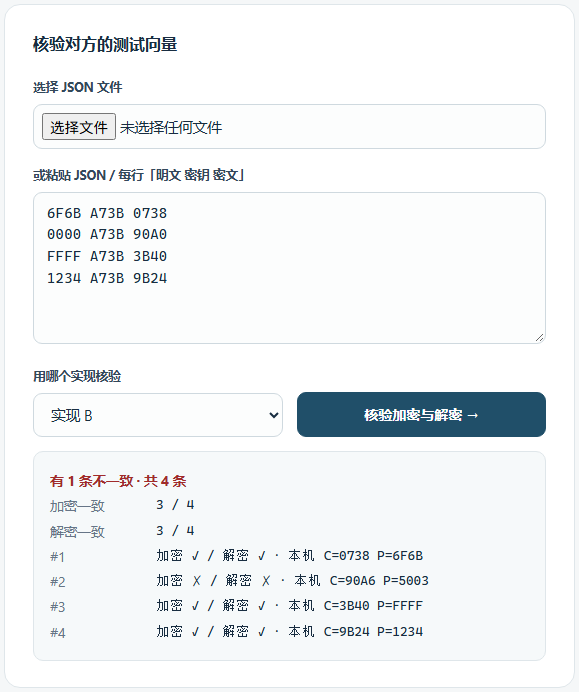

命令行也可以做同样的事：`python -m saes export A73B 6F6B 0000 FFFF` 生成向量，`python -m saes verify 对方的文件` 核验（通过退出码 0，有不一致退出码 1）。

## 第 3 关：字符串

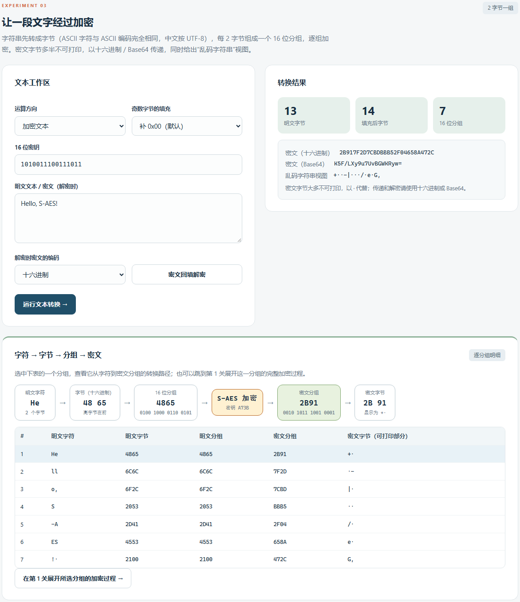

1. 默认文本 `Hello, S-AES!`，密钥 `A73B`，点击“运行文本转换”：13 字节补 1 个 `0x00` 变成 14 字节，共 7 个 16 位分组，密文十六进制 `2B917F2D7CBDBBB52F04658A472C`。
2. 结果区同时给出十六进制、Base64 和“乱码字符串视图”（不可打印字节显示为 `·`）。传递和解密请用十六进制或 Base64，乱码视图只是用来观察。
3. “密文回填解密”把刚才的密文填回并切到解密方向，应还原原文。解密时的密文编码（十六进制 / Base64）由“解密时密文的编码”决定。
4. 下表每行是一个 2 字节分组；点击某一行，上方显示“字符 → 字节 → 16 位分组 → S-AES → 密文分组 → 密文字节”的路径；“在第 1 关展开所选分组的加密过程”会跳到第 1 关，用这个分组和密钥直接看完整的 13 步。
5. 奇数字节的填充方式：`补 0x00`（默认）、`PKCS#7`、`无填充`（奇数字节会被拒绝）。中文按 UTF-8 处理。

## 第 4 关：多重加密

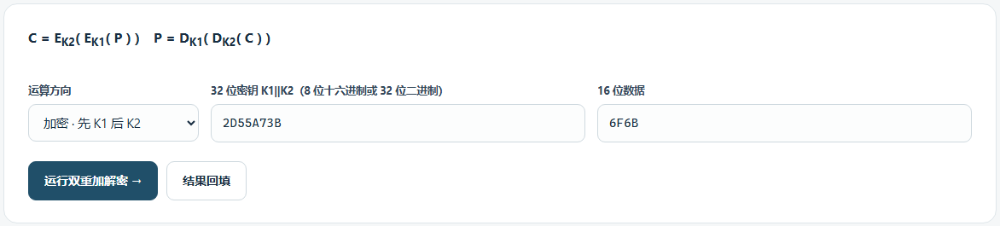

**A 双重加密：** 输入 32 位密钥 `K1‖K2`（默认 `2D55A73B`）和 16 位数据。加密先用 K1 再用 K2，解密相反；计算链显示每一重的输入、密钥和输出。“结果回填”可以直接做回验。

**B 中间相遇攻击：**

1. 默认的 3 对明密文由密钥 `2D55A73B` 生成。点击“运行中间相遇攻击”（约 3 秒），右侧统计显示剩余候选数、分组运算次数、实测耗时和相对穷举 2³² 的运算量比例。
2. “候选密钥随明密文对数增加而收敛”图是对数坐标：全部密钥 4,294,967,296 → 第 1 对后约 6.5 万 → 第 2 对后个位数 → 第 3 对后唯一。图下附表格视图。
3. 试试只保留第一行再运行，候选数约 6.5 万，说明单对明密文无法唯一确定密钥；“随机生成示例（3 对）”换一把新密钥重新攻击。
4. 原理图展示“正向建表、反向查表、在中间值处相遇”；候选表列出前 32 个候选，并核对示例密钥是否在其中（示例密钥只在攻击结束后用来核对，攻击程序看不到它）。

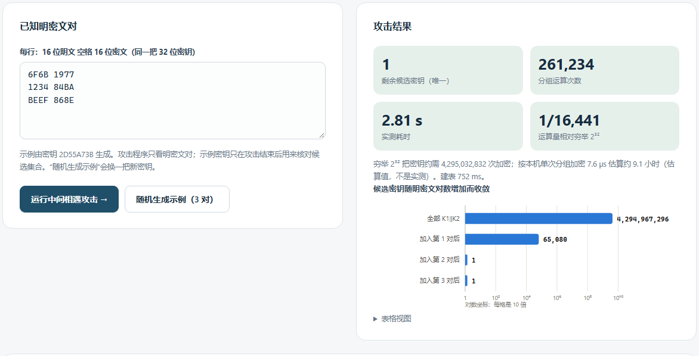

**C 三重加密：** 两种密钥模式——32 位 `K1‖K2`（`E_K1(D_K2(E_K1(P)))`，K3 取 K1）和 48 位 `K1‖K2‖K3`（`E_K3(D_K2(E_K1(P)))`）。切换模式会自动换上长度合适的默认密钥并重算。

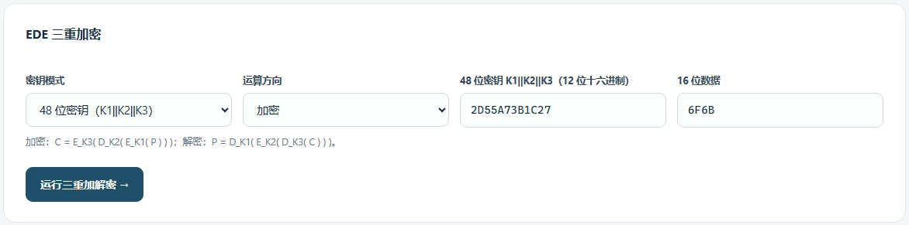

穷举 2³² 的耗时是按本机单次加密速度**估算**的，页面上会明确写出“估算值，不是实测”；中间相遇的耗时是实测。

## 第 5 关：CBC 与篡改对比

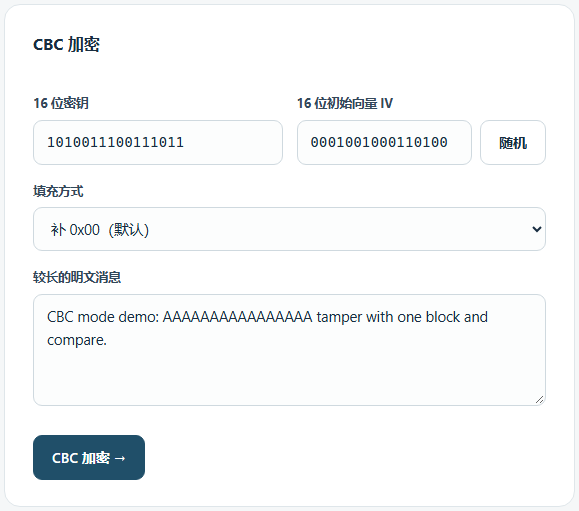

1. 填入密钥、16 位 IV（“随机”按钮用浏览器的 `crypto.getRandomValues` 生成）和较长的明文，点击“CBC 加密”。结果显示分组数、IV，以及同一明文用 ECB 与 CBC 时重复的密文分组数（默认文本里有 16 个连续的 `A`：ECB 重复 7 个，CBC 为 0）。
2. “传输包”是 `IV ‖ 密文`（十六进制），接收方必须拿到同一个 IV 才能解密；点“用它做解密”会把传输包填到下方的“CBC 解密”。解密框里 IV 留空时，取传输包的前 2 个字节作为 IV；也可以手填 IV 来演示用错 IV 的后果（只有第 1 个分组出错）。
3. 加密链图显示前 8 个分组：每个明文分组先与前一个密文分组（第一个是 IV）异或，再加密。

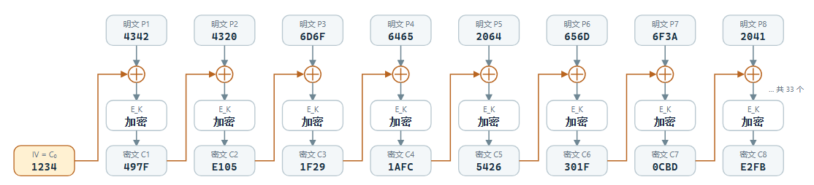

**篡改实验：** 选择改动方式——替换为另一个分组的密文、翻转 1 位、设为自定义值、交换两个分组——和目标分组（从 1 开始），点击“篡改并对比解密结果”。结果是每个明文分组一格的状态条，用图标 + 文字 + 色条同时表示：

- ✓ **未受影响**（绿色）；
- ⚠ **位翻转（可预测）**（琥珀色）：紧接在被改分组之后的那个分组，与原文恰好相差 `Cᵢ ⊕ C′ᵢ`；
- ✕ **整块乱码**（红色）：被改动的密文分组对应的明文分组。

下面还有“原文解密 / 篡改后解密”的逐块对照（块底部的色条与状态一致）、文字说明和逐分组数值表。

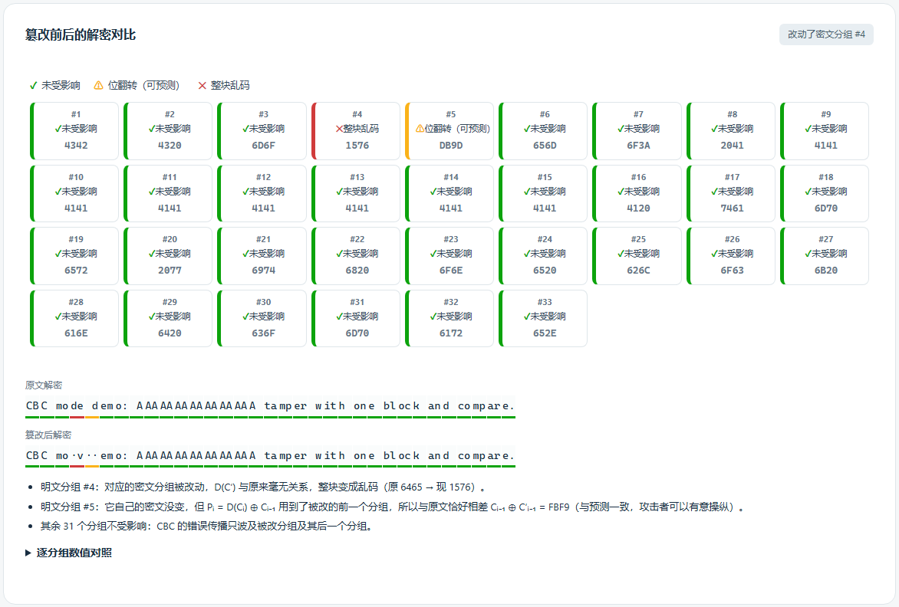

## 一键闯关

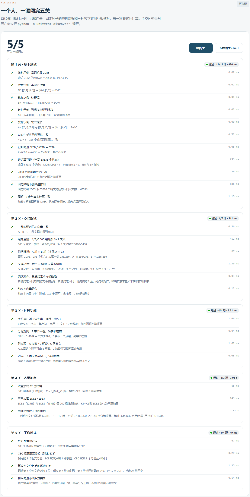

“一键闯关”依次运行五关的自检（教材示例、已知向量、固定种子的随机数据、三种实现互相核对），每项都实际计算，并显示用时；全部通过时五个关卡标签上会出现 ✓。第 4 关含一次中间相遇攻击，整体约需 5 秒。“下载闯关记录”保存 JSON。全空间穷举对照放在命令行测试里：`python -m unittest discover`。

## 命令行

`python -m saes <命令>` 与网页共用同一套代码：

| 命令 | 作用 |
| --- | --- |
| `encrypt <数据> <密钥> [--impl A\|B\|C]`、`decrypt …` | 加密 / 解密一个 16 位分组 |
| `trace <数据> <密钥> [--decrypt]` | 输出图解的 13 步（JSON） |
| `ascii-encrypt <密钥> <文本>`、`ascii-decrypt <密钥> <密文> [--format base64]` | 第 3 关 |
| `double-encrypt / double-decrypt <32 位密钥> <数据>` | 双重加密 |
| `triple-encrypt / triple-decrypt <ede2\|ede3> <密钥> <数据>` | 三重加密 |
| `mitm <明密文对文件>` | 中间相遇攻击（文件每行 `明文 密文`，见 [examples/mitm-pairs.txt](../examples/mitm-pairs.txt)） |
| `cbc-encrypt <密钥> <IV 或 -> <文本>`、`cbc-decrypt <密钥> <IV> <密文>` | CBC；IV 写 `-` 表示随机生成 |
| `export <密钥> <明文…>`、`verify <文件>` | 交换文件的生成与核验 |
| `selftest [关卡]` | 运行五关自检 |

输入错误返回退出码 2 并给出提示；`verify` / `selftest` 有不一致时返回 1。

## 常见问题

| 现象 | 检查 |
| --- | --- |
| 打不开页面或提示“无法连接本地服务” | 终端里 `python app.py` 是否还在运行；地址和端口是否一致 |
| 提示“必须是 16 位二进制或 4 位十六进制” | 长度必须正好是 16 / 4（32 位密钥 32 / 8，48 位密钥 48 / 12）；不会自动补零 |
| 和别的小组的密文不一样 | 先用 `6F6B / A73B → 0738` 对；常见原因：半字节按行而不是按列排列、S 盒抄错、第 2 轮多做了列混淆、RCON 不同、位序反了 |
| 解密得到乱码 | 密钥、IV、填充方式是否与加密时一致；填充无法去除时页面会提示并显示原始字节 |
| 中间相遇攻击候选很多 | 只给 1 对明密文时候选约 6.5 万是正常的，增加明密文对 |
| 动画太快 | 暂停后单步前进，或选择 0.5× 速度，或直接在下拉框选步骤；系统启用“减少动态效果”时不播放动画，仍可单步 |
| 窄屏下图解显示不全 | 手机竖屏时图解改为上下排列；较宽的图在框内可横向滚动 |
